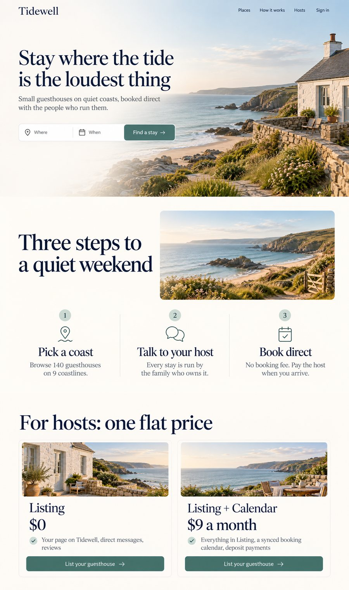

# Browser LLM API

An OpenAI-compatible API over your signed-in ChatGPT and Gemini web sessions, with design tools that make website sections, app screens and brand images with ChatGPT's image tool.

  

Browser LLM API drives a real, logged-in ChatGPT and Gemini session through an automated Chrome ([`nodriver`](https://github.com/ultrafunkamsterdam/nodriver)) and exposes it as the HTTP API your tools already speak. Point any OpenAI SDK, script or agent at `http://localhost:8081/v1` and you get streaming chat, vision, and image generation and editing, on the plan you already pay for, from your own machine.

```python
from openai import OpenAI

client = OpenAI(base_url="http://localhost:8081/v1", api_key="not-needed")
client.chat.completions.create(
    model="chatgpt-browser",   # the default; "gemini-browser" for Gemini
    messages=[{"role": "user", "content": "Write a haiku about local-first AI."}],
)
```

> The honest catch: this automates signed-in sessions on sites that offer no API for this use. It is fragile by nature, because a change to either site's page can break it until the selectors are updated. It may conflict with each provider's terms of service, and it is meant for personal and team use on your own account. See the [disclaimer](#disclaimer).

## What it does

- **Chat.** `/v1/chat/completions`, streaming or not, with OpenAI's request and response shapes, so the OpenAI SDK, LangChain and most tools work unchanged. Send images in as vision content parts.
- **Images.** `/v1/images/generations` and `/v1/images/edits` return a saved file and a link. ChatGPT is put into its own Create image mode for every image request.
- **Design.** `browser-llm design` makes one large, readable image per website section or app screen, keeps a set in one design system, reads the design back out as CSS tokens, and reviews a screenshot of your build against the design.
- **Agents.** An MCP server gives Claude Code, Claude Desktop, Cursor or Zed the tools `ask`, `generate_image`, `design_set`, `design_tokens`, `design_review`, `list_models` and `health`.
- **Interfaces.** A web dashboard with chat history, a Studio for images, a gallery, live server status and a `Ctrl+K` palette; an embeddable chat widget that a page can drive from JavaScript; and a native Linux tray app.

| `model` | Site | Makes images | Takes images in |
|---|---|---|---|
| `chatgpt-browser` (default) | chatgpt.com | yes | yes |
| `gemini-browser` | gemini.google.com | when `IMAGE_PROVIDERS` allows it | yes |

### Scope

In scope: one person's or one team's signed-in ChatGPT and Gemini sessions on a Linux machine, one request at a time per provider, used from scripts, agents, the dashboard and the widget. Out of scope: pooling several accounts, parallel requests to one provider, headless Chrome (both sites block it, so a background run uses an Xvfb display), and Windows or macOS, which are untested. Version 2.0 removed forwarding a model from one install to another; a second machine calls this API directly with a key.

## Install and first run

You need Linux, Python 3.12, Google Chrome, and for a background run the `xvfb` package.

```bash
git clone https://github.com/StaticB1/browser-llm-api.git
cd browser-llm-api
scripts/ensure-venv.sh            # builds ./venv and installs the package in it
```

`scripts/install-service.sh` instead sets up the same venv, then registers a `systemd --user` service and a watchdog for this checkout. [Running it](docs/running.md) covers the service, the display and the watchdog.

Then sign in, start the server and ask something:

```bash
# 1. Sign in once per provider, on a visible display. A Chrome window opens; sign in; it closes itself.
DISPLAY=:1 ./venv/bin/browser-llm login chatgpt          # and/or: gemini

# 2. Start the server (or let the service run it).
./serve.sh                                               # http://localhost:8081

# 3. Ask something.
./venv/bin/browser-llm ask "hello"
curl http://localhost:8081/v1/chat/completions -H 'Content-Type: application/json' \
  -d '{"model":"chatgpt-browser","messages":[{"role":"user","content":"hello"}]}'
```

Then open `http://localhost:8081/` for the dashboard. An empty first answer, or a sign-in or "verify you're human" wall, means that provider's session needs a fresh login: see [Running it](docs/running.md#signing-in).

## Design in three commands

```bash
# One image per section, all in one design system. --dry-run first shows every prompt for free.
./venv/bin/browser-llm design set --kind section \
  --brief "Tidewell, a booking site for quiet seaside guesthouses; it must get people to search" \
  --section "Hero: headline 'Stay where the tide is the loudest thing', button 'Find a stay'" \
  --section "How it works: three steps" --section "Pricing for hosts: two plans" --out designs/home

# Read the design system back out: tokens.json, tokens.css, DESIGN.md
./venv/bin/browser-llm design tokens designs/home/0*.png --out designs/home

# After building it: compare a 1440-wide screenshot with the design
./venv/bin/browser-llm design review --design designs/home/01-hero.png --build shot.png --width 1440
```



[Images and design](docs/images-and-design.md) explains the thirteen kinds, sets, tokens and review, and [the design upgrade write-up](docs/design-upgrade.md) shows a measured run.

## Documentation

| Page | Covers |
|---|---|
| [Quickstart](docs/quickstart.md) | The shortest path to a working setup and every common command |
| [API](docs/api.md) | Endpoints, request and response fields, attachments, errors |
| [Images and design](docs/images-and-design.md) | Image generation, limits, assets, design kinds, sets, tokens, review |
| [Agent image guide](docs/agent-image-guide.md) | Instructions to hand a coding agent that needs real image assets |
| [MCP](docs/mcp.md) | Setting up the MCP server and what each tool does |
| [Web UI](docs/web-ui.md) | The dashboard, the embeddable widget and the desktop app |
| [Configuration](docs/configuration.md) | Every setting, the `.env` file, and who can call the API |
| [Running it](docs/running.md) | The service, the display, signing in, the watchdog, troubleshooting |
| [Architecture](docs/architecture.md) | How a request flows, providers, and the parts that are tested |
| [Changelog](CHANGELOG.md) | What changed in each version, including upgrading from 0.x |
| [Contributing](CONTRIBUTING.md) | Development setup, tests, fixing a site change, releasing |
| [Security](SECURITY.md) | Threat model and how to report a problem |

## Project layout

```
browser_llm/            the package: server, providers, design, CLI, MCP server, dashboard
  providers/            one adapter per site (chatgpt.py, gemini.py) behind a common interface
  webui/                dashboard, widget and demo page (single files, no build step)
scripts/                serve, install-service, ensure-venv, healthcheck, mcp, mode
deploy/systemd/         templates for the service and the watchdog timer
desktop/                the native Linux tray app (GTK3, standard library only)
docs/                   the pages above
tests/                  unit tests; no browser and no network
gen_asset.py design.py client.py serve.sh mcp.sh healthcheck.sh
                        forwarding files for callers that use the pre-2.0 paths
```

## Authors

Browser LLM API is built by Statotech Systems in partnership with [Ebenworks](https://ebenworks.co/): [staticB1](https://github.com/StaticB1) and Ebenezer "Ebstar" Tarubinga. Contributions are welcome; see [Contributing](CONTRIBUTING.md).

## License

[MIT](LICENSE). The version lives in `browser_llm/_version.py` and shows at `/version`, `/api/status` and at the foot of the dashboard's rail.

## Disclaimer

This tool automates signed-in sessions on third-party sites (chatgpt.com, gemini.google.com) that offer no API for this use. It may violate those services' terms of service, a change to either site can break it at any time, and it acts with your own account. Use it for personal and experimental purposes, at your own risk, and read each provider's terms. The authors provide no warranty (see [LICENSE](LICENSE)).
