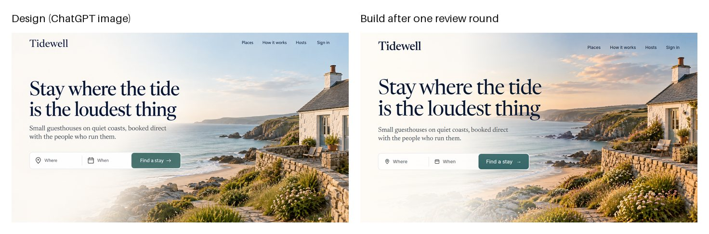

# Designing with ChatGPT images: audit and upgrade

14 October 2026. Written for Eben, who asked for image generation "like Codex, Astra" for frontend, UI, UX and design work.

The local ChatGPT bridge now designs the way Codex does with GPT-6 Astra and Images 2.0. It makes one large, readable image per website section or app screen and keeps the set in one design system by attaching earlier images as references. It then reads the design back out as tokens and compares a screenshot of the build with the design. Every image request now switches ChatGPT into its own Create image mode first. A live test on 14 October made a three-section landing page, its hero photograph, tokens, and two reviews of a hand-built hero, using six images. Every image ran in Create image mode, every word in the designs matched the brief, and one round of the review's fixes raised the build's match from 77 to 82 out of 100. The test also found two faults, which are fixed: sections copied parts of their references, and two references were uploaded as three images.

## What the bridge could not do before

The bridge already made good single images. A caller sent a prompt, the server typed it into ChatGPT with one sentence asking for the image tool, and a wrapper cropped the result to exact pixels. That covered hero backgrounds, icons and favicons. It did not cover design work, and the audit found six gaps.

First, the image tool was requested in words only. A thinking model can answer a request like "a misty forest at dawn" with prose, so the sentence was a hope rather than a guarantee. ChatGPT's composer has had a Create image mode in its plus menu, and nothing used it.

Second, the bridge had no idea what a design image is. A website section, an app screen, a component sheet and a brand board each need different rules to be buildable: readable text, a real grid, a phone frame, exact labels. Every caller had to write those rules again, and most did not.

Third, images were independent. Ask for a hero and then a pricing section, and they came back as two different websites. Nothing carried the palette, type or spacing from one image to the next.

Fourth, nothing turned a design image back into numbers a developer can use. Colours, type sizes and spacing had to be guessed by eye. Fifth, there was no loop that checked a build against its design. Sixth, the dashboard had a single free-text box, and the agent tools offered one asset at a time.

Two limits are fixed by the platform rather than by the bridge. ChatGPT's web image tool draws a few set shapes near the requested ratio, around 1,250 to 1,730 pixels on the long side. It cannot be asked for the 2K or 4K sizes the paid image API offers. A request may also carry six attachments, where the API takes sixteen reference images.

## How Codex and Astra design with images

The workflow people describe with GPT-6 Astra in Codex is image-first. The model decides what each section needs, generates a picture of that section, studies it, and only then writes code. Griffin Wooldridge's test of Astra built a whole travel site this way, with the imagery and layout produced in one pass. A developer writing on DEV Community reported fewer iterations per hero once a folder of brand references acted as one style anchor for every generation.

Three habits make it work, and the upgrade copies all three. One section goes in one image, because a whole page squeezed into one frame leaves the text too small to read back. Your own image-to-code skill states the same rule for Codex. Consistency comes from reference images, with earlier output fed back into each new request. And the loop closes with screenshots: build, capture at the design's width, compare, and fix.

What the bridge cannot copy is the batch side of the paid API. It cannot request ten images in one call, run several at once, or set an exact pixel size. It drives one ChatGPT account through one browser tab, one image at a time. Each image takes about a minute, and the account allows 120 images a day, with 10 kept for you.

The accounts above come from [Griffin Wooldridge's Astra web design test](https://griffinwooldridge.com/blog/gpt-6-astra-web-design-test), [Daniel Vaughan's guide to image generation in Codex](https://codex.danielvaughan.com/2026/04/27/codex-cli-image-generation-gpt-image-2-visual-development-workflows/), [a DEV Community post on GPT Image 2 inside Codex](https://dev.to/ji_ai/gpt-image-2-inside-codex-my-new-frontend-workflow-4d7n) and [the astra-frontend-design skill](https://github.com/Enixes/astra-frontend-design).

## What the upgrade adds

A new design tool sits beside the existing asset wrapper and shares its image path. It defines thirteen kinds in four groups:

| Group | Kinds |
|---|---|
| Web | website section, whole page, hero background, share image |
| App | phone screen, component sheet |
| Brand | brand board, icon, four logo concepts |
| Content | illustration, labelled diagram, texture, avatar |

Each kind wraps the brief in rules that make the image buildable and brings a default size and background. Icons, illustrations and avatars ask for transparency, and share images crop to exactly 1200 by 630.

A set runs one image per section or screen, in order. The first image becomes the style source. Every later image is made with the first image and the one before it attached, together with your own logo or brand references. Progress is saved after every image, so a set stopped by the daily limit, a crash or a changed section resumes where it left off. Before it spends anything, the set compares the images it plans with what is left of the day's allowance and refuses with the numbers if it will not fit. An option can ask for three candidate directions for the first section and stop so one can be picked.

The tokens step sends up to six finished images back to ChatGPT. It asks for colours, typefaces, type scale, spacing, radii, shadows, components and a description of each section's layout. It also measures the most common colours from the pixels, so a guessed colour can be checked against a measured one. The output is a JSON file, a CSS file of custom properties, and a design document for the coding step.

The review step compares a screenshot of the build with its design. It returns a match score and a list of differences, each with a severity and a fix written in CSS terms. It can also critique a single screenshot.

All of this reaches every entry point. The image API takes the kind options and reports the exact prompt typed. The agent tools gained three design tools. The dashboard's Create image page has a presets row and shows the prompt sent under each result.

```bash
./venv/bin/python design.py set --kind section --brief "..." \
  --section "Hero: ..." --section "Pricing: ..." --out designs/landing
./venv/bin/python design.py tokens designs/landing/0*.png --out designs/landing
./venv/bin/python design.py review --design designs/landing/01-hero.png \
  --build shot-1440.png --width 1440 --out designs/landing/review-hero.md
```

## The decisions and what they cost

You made each of these calls in the interview. The table records what each costs, so the choice can be revisited when the cost shows up.

| Decision | What it costs |
|---|---|
| Prompts carry structure only, with art direction as a switch | Two prompt paths to keep in step. The condensed art direction will drift from your skill files unless both are edited together. |
| Consistency through reference images | Six attachments at most, so a long set keeps only the first and the previous image. Drift across ten sections is still possible. |
| ChatGPT's own Create image mode, with a guard for text requests | One more page element to depend on. If the plus menu moves, requests fall back to words and say so in the response. |
| Pillow upscaling only | Enlarged photographs look softer than with a trained upscaler. Nothing to install. |
| Refuse a set that does not fit the day's images | ChatGPT's counter can overstate what is left, so the refusal is advisory. The site's own limit message stays the real stop. |
| Three directions only on request | A set run without them commits to the first look ChatGPT chooses. |

Two options were left for later. Running a whole set inside one ChatGPT conversation would let the image tool see its own earlier images directly. That needs a new way to drive an existing conversation, and the rule of one tab per browser profile makes it delicate. A trained upscaler would give sharper 2K hero images, but it needs a model download and the graphics card.

## What the live test showed

The test used a made-up booking site for small seaside guesthouses, with three sections: a hero with a search bar, a three-step explanation and two plans for hosts. Each section's content gave the exact words to show. The run used six images and three long text calls on the Plus account. ChatGPT's own counter still read 120 images left afterwards, which confirms again that the counter does not track use.

| Step | Measured on 14 October |
|---|---|
| One section image, Create image mode on | 62 to 96 seconds each |
| Sections made in the mode | 6 of 6, no fallback to words |
| Words in the designs that differ from the brief | none found by eye |
| Tokens from three images | 253 seconds, a 17,336-character answer |
| Review of the build against the design | 263 and 473 seconds |
| Build match, first and second review | 77 and 82 out of 100 |


The set held one design system. The serif headings, the teal button, the ivory background and the photo grade carried from the hero into both later sections. The first run had a real flaw: the second section repeated the hero's search bar, and the third reused a near copy of the second section's photograph. The references sentence now tells the image tool not to repeat the references' components, photographs or text. The rerun produced three distinct layouts in the same system.

The same run exposed a duplicate-upload bug that predates this work. The page offers four hidden file inputs, and the first is the camera input, which takes one file. Given two references, it took one, and the uploader passed both to the next input, so ChatGPT received three images. Inputs that take several files now rank first, and an input that takes only some files receives the rest one at a time. The rerun attached both references in under three seconds, and the sent message held exactly two images.

The tokens matched what the pixels show where it matters. The button colour came back as the measured teal, and the type scale was plausible. About half the colours were photograph tones turned into interface tokens, so the prompt now keeps photographs out of the colour list. A rerun with that prompt returned 9 colours instead of 16, all of them interface colours, and described the photograph tones under imagery.



The review earned its place. Its first finding was a real bug in the hand-built page, where the content sat about 75 pixels too far right because both a container width and side padding were applied. It also caught the warmer photograph and a headline face that was too thin. One round of its fixes raised the match from 77 to 82 and cut the findings from 20 to 14. Its pixel estimates are approximate, though. It asked for an 86- to 88-pixel headline in round one and called 88 pixels oversized in round two.

The test cut across other work once. A restart to load a fix landed while another session's evaluation request was being answered, and that request returned a partial reply. The service notes now say to check that no provider is busy before restarting, and later restarts waited for that.


## Limits worth knowing

The upgrade inherits the bridge's main weakness. Every step depends on ChatGPT's page staying as it was measured, and a redesign can silently break the image mode or the image reads. The image mode is the newest dependency. When the plus menu cannot be found, requests still work in words, but the response says the mode was off, and that is the signal to look at the page.

Reference images make a set consistent, not identical. The image tool reads the references as strong guidance, so the type and colour hold well, but spacing and component details can wander, more so in long sets. The tokens step and the build should treat the first section as the authority. A section that drifts too far can be made again on its own.

The tokens are estimates. ChatGPT reads sizes from a picture, so a 64-pixel heading may come back as 60 or 72. The measured colours are reliable for large flat areas and less so for small accents. The design document says this at the top, and the review step catches what the estimate gets wrong.

One fault is still open. Twice on the test day, a long text answer at GPT-6 High came back empty after three to five minutes, although ChatGPT's record shows it answered. The same request at Medium returned over ten thousand characters, and the tokens step read a seventeen-thousand-character answer at High without trouble. The page reader used to turn a script error into empty text without saying so. It now logs the cause, so the next occurrence can be traced.

Agent clients can time out long calls. A set of more than six images takes over six minutes, so it is better run from the command line in the background. It keeps going after a timed-out call and resumes when called again.
